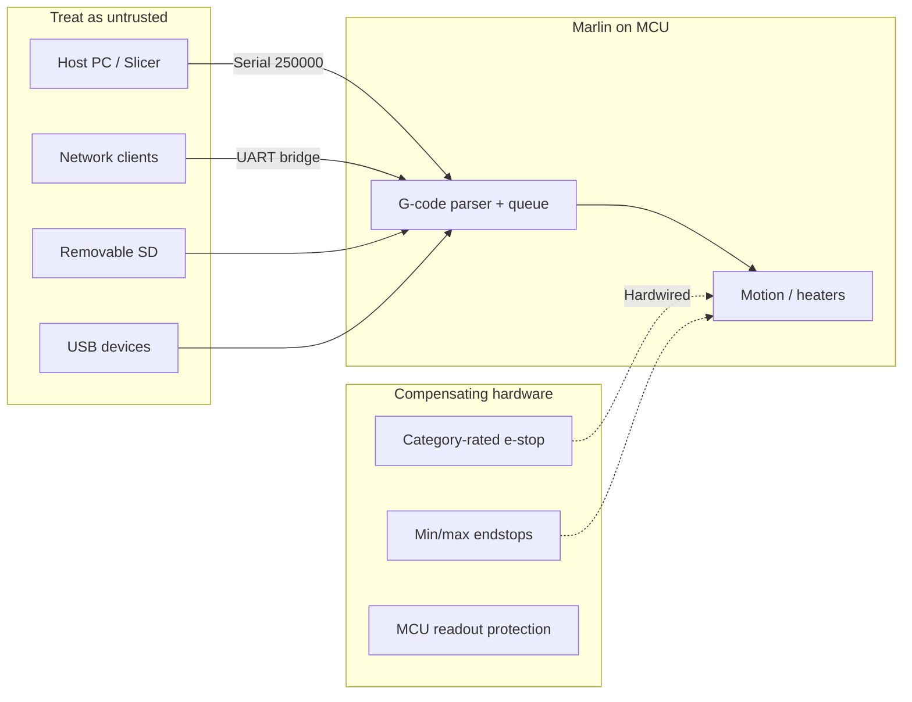

# Security Guide — MarlinV2_morphle

This document describes the security posture, threats, and recommended practices for **MarlinV2_morphle**: a Morphle-maintained fork of [Marlin 2.1.x](https://github.com/MarlinFirmware/Marlin) (bugfix branch) used to control motion and thermal subsystems on additive and related machines. It is based on review of this repository, upstream Marlin behavior, and industry guidance from standards bodies, government advisories, and peer-reviewed research.

**Audience:** firmware engineers, integrators, operators, and security reviewers deploying this codebase on production hardware.

**Last reviewed:** 2026-11-12 (against tree at `security-documentation` / `7c0b465754`).

---

## Table of contents

1. [Scope and limitations](#1-scope-and-limitations)
2. [Threat model](#2-threat-model)
3. [Architecture and attack surface (this repo)](#3-architecture-and-attack-surface-this-repo)
4. [Default configuration security notes](#4-default-configuration-security-notes)
5. [Firmware safety mechanisms](#5-firmware-safety-mechanisms)
6. [Input paths: G-code, serial, storage, network](#6-input-paths-g-code-serial-storage-network)
7. [Physical and operational safety](#7-physical-and-operational-safety)
8. [Device hardening and lifecycle](#8-device-hardening-and-lifecycle)
9. [Supply chain and compliance](#9-supply-chain-and-compliance)
10. [Recommended configuration checklist](#10-recommended-configuration-checklist)
11. [Incident response](#11-incident-response)
12. [Reporting security issues](#12-reporting-security-issues)
13. [References](#13-references)

---

## 1. Scope and limitations

### 1.1 What this firmware is

- **Motion and process controller firmware** for microcontrollers (AVR, STM32, LPC, ESP32, Teensy, SAMD, etc.) via Marlin’s Hardware Abstraction Layer.
- **Licensed under GPL v3** with no warranty; see [`LICENSE`](LICENSE) and [GNU GPL §15–16](https://www.gnu.org/licenses/gpl-3.0.en.html).
- **Not a safety-rated product.** Marlin explicitly states that `M112` and similar mechanisms are **control stops**, not certified Emergency Stop (e-stop) devices meeting a Performance Level (PL) or Safety Integrity Level (SIL). Machine builders must perform their own risk assessment ([Marlin M112 documentation](https://marlinfw.org/docs/gcode/M112.html)).

### 1.2 What this document is not

- A penetration test report or formal risk assessment for a specific Morphle product.
- A substitute for machine-level standards (e.g., ISO 12100 risk assessment, ISO 13849 functional safety, IEC 61508).
- A promise that any configuration is “secure” in the IT sense; many valid G-code sequences can damage hardware or create fire risk if the machine lacks mechanical safeguards ([Marlin issue #23538](https://github.com/MarlinFirmware/Marlin/issues/23538)).

### 1.3 Repository context

| Item | Value |
|------|--------|
| Remote | `git@github.com:morphiens/MarlinV2_morphle.git` |
| Base | Marlin **2.1.x bugfix** (configuration version `02010300` in `Marlin/Configuration.h`) |
| Product-specific branding in tree | No `morphle`/`robotome` strings in source; treat as **upstream Marlin + your product `Configuration.h`** |

Morphle teams should maintain **product configuration** (board, pins, limits, thermal limits) in version control separately from upstream merges and document deviations in release notes.

---

## 2. Threat model

### 2.1 Assets

| Asset | Why it matters |
|-------|----------------|
| **Physical machine** | Motors, heaters, lasers/spindles can cause injury, fire, or equipment damage |
| **Firmware integrity** | Malicious or corrupt images alter behavior persistently |
| **G-code / job files** | Direct control of motion and temperature |
| **EEPROM / settings** | Persistent changes (steps/mm, max temp, soft limits) |
| **Serial / network path** | Full administrative G-code on every enabled port |
| **SD / USB storage** | Bootable `firmware.bin`, job files, macro scripts |

### 2.2 Adversary classes (aligned with academic models)

Research on Marlin-class firmware (e.g., [USENIX Security ’25 — malicious G-codes](https://www.usenix.org/system/files/usenixsecurity25-rossel.pdf), [WOOT ’24 — firmware attacks on FFF](https://www.usenix.org/system/files/woot24-rais.pdf)) defines capabilities from **minimal serial access (AC3)** through **full G-code control (AC4)**. This repo inherits Marlin’s model: **any host on a serial port is effectively a root operator** unless external controls compensate.

| Class | Capability | Example |
|-------|------------|---------|
| **Operator (authorized)** | USB/serial, SD, UI | Slicer, OctoPrint, panel |
| **Network peer** | Wi‑Fi/Ethernet bridge to UART | ESP3D, MKS WiFi, tethered SBC |
| **Local attacker** | USB, SD swap, brief physical access | Malicious `firmware.bin` on SD |
| **Remote attacker** | Exposed OctoPrint, open Wi‑Fi, cloud tunnel | G-code injection mid-print |
| **Supply chain** | Compromised build, dependency, or config | Trojanized `lib_deps` or CI artifact |

### 2.3 Trust boundaries

**Design principle (IEC 62443 / CISA ICS):** Marlin is an **OT endpoint**. Do not expose it to the Internet; segment it from corporate IT; assume **integrity of G-code cannot be enforced by firmware alone** without additional policy and hardware.

---

## 3. Architecture and attack surface (this repo)

### 3.1 Code layout (security-relevant)

| Area | Path | Notes |
|------|------|--------|
| G-code parsing | `Marlin/src/gcode/parser.cpp`, `Marlin/src/gcode/queue.cpp` | Primary external input surface |
| Emergency intercept | `Marlin/src/feature/emergency_parser.cpp` | Optional; off in default `Configuration_adv.h` |
| Kill / halt | `Marlin/src/MarlinCore.cpp` (`kill()`, `minkill()`) | Heaters off, steppers optional |
| Thermal | `Marlin/src/module/temperature.cpp` | Runaway state machine, `_temp_error` |
| Password UI feature | `Marlin/src/feature/password/` | UI/access control only (not G-code auth) |
| Binary SD upload | `Marlin/src/feature/binary_stream.cpp`, `buildroot/share/scripts/MarlinBinaryProtocol.py` | Can write `firmware.bin` when enabled |
| Multi-serial | `Marlin/src/core/serial_hook.h`, `docs/Serial.md` | All ports get full G-code ([host interface](https://marlinfw.org/docs/features/host_interface.html)) |
| HAL USB / WiFi | `Marlin/src/HAL/ESP32/`, MKS WiFi UI | Extra bridges; M112 handling varies if `EMERGENCY_PARSER` disabled |
| Web UI assets | `buildroot/web-ui/` | Browser-based console; security depends on deployment |
| PlatformIO / deps | `ini/*.ini`, `platformio.ini` | Build-time supply chain |

### 3.2 Critical upstream caveat (Marlin maintainers)

From [Marlin #23538](https://github.com/MarlinFirmware/Marlin/issues/23538#issuecomment): firmware cannot be considered safe against malicious USB, SD, or G-code **without** hardware limits (min **and** max endstops or equivalent), thermal supervision, physical access control, and operator policy. **`M121` (disable soft endstops)** and sustained heating commands remain dangerous on DIY hardware.

---

## 4. Default configuration security notes

The checked-in `Marlin/Configuration.h` and `Marlin/Configuration_adv.h` are **generic templates**, not a hardened product profile.

| Setting | Default in tree | Security implication |
|---------|-----------------|----------------------|
| `SERIAL_PORT` | `0` @ `250000` | Single UART host; match baud; protect cable |
| `SERIAL_PORT_2` / `_3` | Disabled | Enable only with intent; each port = full G-code |
| `EMERGENCY_PARSER` | **Commented out** | `M112`/`M108` may wait in queue during blocking waits |
| `PASSWORD_FEATURE` | **Commented out** | No UI lock; even if enabled, **does not block G-code** ([docs](https://marlinfw.org/docs/settings/security.html)) |
| `BINARY_FILE_TRANSFER` | **Commented out** | Reduces remote firmware drop via serial when disabled |
| `WIFISUPPORT` / `ESP3D_WIFISUPPORT` | **Commented out** | WiFi expands attack surface when enabled |
| `THERMAL_PROTECTION_*` | **Enabled** (hotend/bed/chamber/cooler in `Configuration.h`) | Mitigates runaway; verify tuned for hardware |
| `USE_WATCHDOG` | **Enabled** | MCU reset on firmware hang (not a fire stop) |
| `MOTHERBOARD` | `BOARD_RAMPS_14_EFB` | **Must be overridden** for production Morphle boards |

**Action for Morphle releases:** Ship a **named production config** (not defaults), with `STRING_CONFIG_H_AUTHOR`, `CUSTOM_MACHINE_NAME`, and documented security-relevant defines.

---

## 5. Firmware safety mechanisms

These are **mitigations**, not guarantees.

### 5.1 Thermal protection and runaway

- `THERMAL_PROTECTION_HOTENDS`, `BED`, `CHAMBER`, `COOLER` trigger shutdown via `_temp_error()` and runaway state machine (`TRRunaway` in `temperature.cpp`).
- Hosts can detect capability via `Cap:THERMAL_PROTECTION:1` in `M115` ([RepRap capabilities](https://www.reprap.org/wiki/Firmware_Capabilities_Protocol/ua)).
- **Operator duty:** verify sensor type, wiring, and `THERMAL_PROTECTION_*_PERIOD` / hysteresis for your machine. Disabled or misconfigured sensors remain a fire hazard ([LBL EHS guidance](https://ehs.lbl.gov/service/3d-printing-equipment/3d-printer-hazards/fire-prevention-and-thermal-control/)).

### 5.2 Watchdog

`USE_WATCHDOG` resets stuck firmware. It does **not** replace human supervision or hardware e-stop.

### 5.3 Endstops and motion bounds

- **Software endstops** can be disabled with `M121` unless prevented by build policy.
- **Hardware** min/max switches are the primary defense against malicious motion beyond mechanical limits (per Marlin security discussion).

### 5.4 Kill pin and `M112`

- `KILL_PIN` is board-specific in `Marlin/src/pins/**`.
- `M112` calls `kill()` — not safety-rated ([M112 docs](https://marlinfw.org/docs/gcode/M112.html)).
- Enable `EMERGENCY_PARSER` where HAL supports it so `M108`/`M112`/`M410` are parsed from the RX stream ([`Configuration_adv.h`](Marlin/Configuration_adv.h) ~2447, [`emergency_parser.cpp`](Marlin/src/feature/emergency_parser.cpp)).

### 5.5 Cold extrusion and length limits

`PREVENT_COLD_EXTRUSION` and `PREVENT_LENGTHY_EXTRUDE` reduce some abuse; `M302` can change cold extrude policy at runtime if enabled.

---

## 6. Input paths: G-code, serial, storage, network

### 6.1 G-code

- **278+ potentially dangerous G-codes** identified in recent taxonomy ([USENIX ’25](https://www.usenix.org/system/files/usenixsecurity25-rossel.pdf)); countermeasures include disabling unused codes (vendor patches), **resetting machine state between jobs**, and integrity checks on job files.
- **Line number + checksum** optional for host protocols; reduces corrupted commands, not malicious hosts ([host interface](https://marlinfw.org/docs/features/host_interface.html)).
- Marlin **does not implement** command-level RBAC for G-code. `PASSWORD_FEATURE` is **LCD access control** and can be bypassed via serial ([PR #18399](https://github.com/MarlinFirmware/Marlin/pull/18399)).

**Morphle recommendations:**

1. Treat sliced G-code like code from the internet: scan, version, and sign job bundles where policy requires it.
2. On shared / service printers, run `M502`/`M500` reset scripts or vendor reset G-code after each job where appropriate ([USENIX countermeasure discussion](https://www.usenix.org/system/files/usenixsecurity25-rossel.pdf)).
3. Cap `MAX_FEEDRATE_EDIT_VALUES` and max temps in config to mechanical limits.
4. Do not expose raw serial to untrusted apps without a gated proxy.

### 6.2 Serial and USB

- Native USB (`SERIAL_PORT -1`) exposes bootloader + G-code on many boards.
- `SERIAL_OVERRUN_PROTECTION` is enabled in default `Configuration_adv.h` (buffer safety).
- **Meatpack** / compression features alter bandwidth, not auth.

### 6.3 SD card and USB mass storage

- Untrusted SD files: macros, auto0.g, `firmware.bin` for bootloader-based update (board-dependent).
- Validate media source; use physical locks on SD slots in public environments.

### 6.4 Binary file transfer (`BINARY_FILE_TRANSFER`)

When enabled (`Configuration_adv.h` ~1727):

- Host sends `M28 B1`, then binary protocol writes files (often `firmware.bin`) on onboard SD.
- Protocol emphasizes **integrity ACKs**, not **authentication** ([Binary protocol docs](https://github.com/navaismo/Marlin_bugfix_2.1_E3V3SE/blob/for_E3V3SE/docs/BinaryFileTransferProtocol.md), [OctoPrint BFT notes](https://github.com/OctoPrint/OctoPrint-FirmwareUpdater/blob/master/doc/marlinbft.md)).
- Typical update ends with `M997` reset — a failed transfer can brick until physical SD recovery ([issue #286](https://github.com/OctoPrint/OctoPrint-FirmwareUpdater/issues/286)).

**Policy:** Keep disabled on network-attached printers unless updates occur over a physically controlled link with post-transfer verification.

### 6.5 WiFi / ESP3D / Web UI

- `WIFISUPPORT` / `ESP3D_WIFISUPPORT` (`Configuration_adv.h` ~4069) allow WiFi credentials in build or via G-code (`M118 [ESP110]...` example nearby in config).
- **OWASP IoT Top 10:** weak/default credentials and open services ([OWASP IoT](https://owasp.org/projects/internet-of-things?tab=seek-and-understand)).
- **CISA:** never expose control devices directly to the Internet; use VPN with hardened clients ([ICS advisory pattern](https://www.cisa.gov/news-events/ics-advisories/icsa-25-275-01)).
- `buildroot/web-ui/` provides a browser console — treat as **equivalent to full G-code access** if bridged to the printer.

### 6.6 Line injection and hosts

Research and demos show firmware replacement via USB (e.g., [historical Sprinter upload attacks](https://github.com/secmobi/attack-arduino-and-reprap)) and Trojan G-code embedded in models ([FLAW3D](https://arxiv.org/abs/2104.09562)). Assume **hosts can be compromised**; defense is network segmentation, media control, and hardware limits.

---

## 7. Physical and operational safety

Security and **safety** overlap for additive equipment.

| Control | Guidance |
|---------|----------|
| **Access** | Lockable room/cabinet; trained operators only ([Princeton EHS](https://ehs.princeton.edu/campus-health-safety/3d-printers-campus), [UM Makerspace](https://ehs.umich.edu/wp-content/uploads/2018/09/MakerspaceGuideline.pdf)) |
| **Supervision** | Do not leave high-temperature jobs unattended without monitoring ([LBL](https://ehs.lbl.gov/service/3d-printing-equipment/3d-printer-hazards/fire-prevention-and-thermal-control/)) |
| **E-stop** | Hardware e-stop **in series** with power or drive enable, category per risk assessment (ISO 12100 / ISO 13849) — not `M112` alone ([UL machinery FAQ](https://www.ul.com/news/top-10-questions-webinar-functional-safety-embedded-systems-and-software-used-machinery)) |
| **Fire** | Smoke detection, extinguishers suitable for electrical fires; consider enclosures ([Prusa safety options](https://www.prusa3d.com/product/original-prusa-mk4-s-enclosure-13/)) |
| **Interlocks** | Do not bypass door/lid switches; align with UL industrial AM hazards ([UL Solutions](https://www.ul.com/thecodeauthority/knowledgecenter/code-requirements-industrial-additive-manufacturing-and-3d-printing-equipment)) |
| **Panic / kill** | Accessible power cut independent of firmware |

---

## 8. Device hardening and lifecycle

### 8.1 MCU debug and readout protection (STM32 and similar)

For STM32-based Morphle boards ([ST AN5156 RDP](https://www.st.com/content/st_com/en/technical-documents/an5156-introduction-to-security-for-stm32-mcus-stmicroelectronics_asset/chunk-006-topic-an5156-sec-feat-read-out-protection-rdp-.html)):

- Set **RDP Level 1** minimum on shipped products to block trivial SWD dumping.
- Consider **signed secure boot + secure firmware update** (e.g., [AN5447](https://www.st.com/resource/en/application_note/an5447-overview-of-secure-boot-and-secure-firmware-update-solution-on-arm-trustzone-stm32-microcontrollers-stmicroelectronics.pdf), [MCUboot SBSFU](https://wiki.st.com/stm32mcu/wiki/Security:SBSFU_by_MCUboot)) for high-assurance products.
- Document OEM unlock key handling before RDP2 ([STM32U3 RDP wiki](https://wiki.st.com/stm32mcu/wiki/Security:RDP_for_STM32U3)).

### 8.2 Firmware update policy

| Practice | Source alignment |
|----------|------------------|
| Signed artifacts verified before flash | OWASP ASVS IoT C.19–C.22 ([appendix](https://github.com/OWASP/ASVS/blob/master/4.0/en/0x93-Appendix-C_IoT.md)) |
| Anti-rollback version counters | OWASP ISVS 3.1.x ([ISVS](https://owasp-isvs.gitbook.io/owasp-isvs-pr/security-requirements/v3-software_platform_requirements)) |
| Controlled update path (USB/SD/tooling), not anonymous serial | CISA ICS best practices |
| Test in lab before fleet OTA | NIST SP 800-82 OT guidance ([NIST CSRC](https://csrc.nist.gov/pubs/sp/800/82/r3/final)) |

### 8.3 Network architecture

Apply **defense in depth** for ICS ([CISA PDF](https://www.cisa.gov/sites/default/files/publications/Cybersecurity_Best_Practices_for_Industrial_Control_Systems.pdf)):

- OT VLAN for printers; no inbound from Internet.
- Jump host or VPN for remote support; no permanent vendor VPN tunnels.
- Disable unused services on SBCs (OctoPrint, Kiosk, mDNS).
- Monitor for anomalous serial traffic where feasible.

### 8.4 Logging and monitoring

- Marlin serial logs are limited; use host-side logging with retention and **no secrets** in logs ([OWASP ISVS 1.4.x](https://scriptingxss.github.io/IoT-Security-Verification-Standard-ISVS/en/V1-IoT_Ecosystem_Requirements.html)).
- Align with ITU-T X.1354 monitoring concepts for IoT deployments ([ITU X.1354](https://www.itu.int/epublications/publication/itu-t-x-1354-2024-09-security-controls-for-internet-of-things-systems)).

---

## 9. Supply chain and compliance

### 9.1 Open source and SBOM

- Marlin integrates **PlatformIO** platforms, Arduino cores, LVGL, heatshrink, USB stacks, etc.
- **CISA ESF / OWASP ISVS:** maintain SBOM, monitor CVEs, pin dependencies ([CISA ESF OSS PDF](https://www.cisa.gov/sites/default/files/2024-08/ESF_SECURING_THE_SOFTWARE_SUPPLY_CHAIN%20RECOMMENDED%20PRACTICES%20FOR%20MANAGING%20OPEN%20SOURCE%20SOFTWARE%20AND%20SOFTWARE%20BILL%20OF%20MATERIALS_508.pdf), [Firmware SBOM spec](https://sbomspec.osfw.foundation/)).
- Generate build-time SBOM for release images (e.g., [PlatformIO SBOM tooling](https://git.xpablo.cz/xPablo.cz/platformio-sbom), [sbomify PlatformIO guide](https://sbomify.com/guides/platformio/)); pin `lib_deps` to exact versions ([pinning guidance](https://safeguard.sh/resources/blog/platformio-lib-deps-pinned-or-floating-for-firmware-sbom)).
- Sign release binaries and record provenance ([OWASP DevSecOps signing](https://owasp.github.io/DevSecOpsGuideline/2-Process/2-3-Build/2-3-6-Supply-Chain-Security/2-3-6-2-Artifact-Signing-and-Provenance/)).

### 9.2 Mapping to common frameworks (informative)

| Framework | Relevance to MarlinV2_morphle |
|-----------|--------------------------------|
| **OWASP IoT Top 10** | I2 insecure network services, I4 insecure update, I9 insecure defaults, I10 physical hardening |
| **OWASP ISVS / ASVS IoT appendix** | Debug disable, unique keys, TLS for cloud *adjacent* services (not native Marlin) |
| **NIST CSF / SP 800-82** | OT segmentation, asset inventory, patch/test cycle |
| **NIST SP 800-213** | Device cybersecurity capabilities for procurement |
| **NIST IR 8228** | IoT risk management lifecycle |
| **IEC 62443** | Zones/conduits, SL targets, shared responsibility between OEM and integrator |
| **IEC 62443-3-3 FR** | Identify/authenticate (host-side), integrity (signed FW), restrict data flow (network) |
| **CISA Critical Manufacturing CSF** | Sector implementation guidance |
| **ITU-T X.1354** | IoT security control catalog |
| **GPL v3** | Distribution obligations; no liability for security defects |

---

## 10. Recommended configuration checklist

Use this for **Morphle production builds** (adjust per board and risk assessment).

### Build-time (`Configuration.h` / `Configuration_adv.h` / pins)

- [ ] Correct `MOTHERBOARD` and pin definitions for shipping hardware
- [ ] `STRING_CONFIG_H_AUTHOR` and version identifiers for traceability
- [ ] `THERMAL_PROTECTION_*` enabled and tuned; verify sensors
- [ ] `USE_WATCHDOG` enabled
- [ ] `EMERGENCY_PARSER` enabled **if HAL supports it** (verify STM32F1 USB constraints in `HAL/STM32F1/inc/SanityCheck.h`)
- [ ] Hardware-appropriate `KILL_PIN` wired and tested
- [ ] Min **and** max endstops or proven mechanical hard stops
- [ ] Conservative `HEATER_*_MAXTEMP`, `MAX_FEEDRATE_EDIT_VALUES`, and soft limits
- [ ] `PREVENT_COLD_EXTRUSION` / `PREVENT_LENGTHY_EXTRUDE` as product requires
- [ ] `PASSWORD_FEATURE` only with understanding of limitations; prefer physical access control
- [ ] `BINARY_FILE_TRANSFER` **disabled** unless required for controlled update tooling
- [ ] WiFi: strong credentials, no defaults in source control; disable `WIFI_CUSTOM_COMMAND` unless needed
- [ ] Document any `MKS_WIFI_MODULE`, `ESP3D`, or `SERIAL_PORT_2/3` exposure

### Manufacturing / deployment

- [ ] Flash known-good signed or checksum-published binary
- [ ] Apply MCU RDP / debug lock per ST (or vendor) guidance
- [ ] Record `M115` + `M503` baseline for each unit
- [ ] Segment network; no public serial/WiFi
- [ ] Operator training + posted SOP ([CISA ICS culture](https://www.cisa.gov/sites/default/files/publications/Cybersecurity_Best_Practices_for_Industrial_Control_Systems.pdf))

### Ongoing

- [ ] Monitor Marlin and PlatformIO CVEs against SBOM
- [ ] Rebuild and regression-test on security patches
- [ ] Review host software (OctoPrint, custom Morphle stack) separately — composite risk

---

## 11. Incident response

1. **Physical first:** e-stop / power off if unsafe condition.
2. **Contain:** disconnect serial, network, and USB; remove SD.
3. **Preserve:** capture serial log, last G-code job, `M503` dump, firmware version (`M115`).
4. **Recover:** reflash verified firmware from trusted source; full EEPROM reset if compromise suspected (`M502` + defaults).
5. **Review:** check for unexpected `firmware.bin`, WiFi SSID changes, or EEPROM drift.
6. **Report internally** and to Morphle security contact (below) if supply-chain or product-defect related.

---

## 12. Reporting security issues

1. **Marlin upstream:** [MarlinFirmware/Marlin security advisories](https://github.com/MarlinFirmware/Marlin/security) for core vulnerabilities.
2. **Morphle fork:** report to the Morphle security channel or repository maintainers (`morphiens/MarlinV2_morphle`) with:
   - Affected commit or release tag
   - Board / `MOTHERBOARD` define
   - Steps to reproduce (G-code or physical steps)
   - Impact (confidentiality / integrity / safety)
3. **Do not** open public issues for unpatched exploit details until coordinated disclosure window is agreed.

---

## 13. References

Primary external sources consulted (standards, government, vendor, and research):

| # | Source |
|---|--------|
| 1 | Marlin — [Host interface](https://marlinfw.org/docs/features/host_interface.html) |
| 2 | Marlin — [Security settings (PASSWORD)](https://marlinfw.org/docs/settings/security.html) |
| 3 | Marlin — [M112 full shutdown](https://marlinfw.org/docs/gcode/M112.html) |
| 4 | Marlin — [M108 break/continue](https://marlinfw.org/docs/gcode/M108.html) |
| 5 | Marlin — [Security audit discussion #23538](https://github.com/MarlinFirmware/Marlin/issues/23538) |
| 6 | Marlin — [Password feature limitations PR #18399](https://github.com/MarlinFirmware/Marlin/pull/18399) |
| 7 | Marlin — [Binary file transfer PR #14817](https://github.com/MarlinFirmware/Marlin/pull/14817) |
| 8 | Rossel et al. — [Security Implications of Malicious G-Codes (USENIX Security ’25)](https://www.usenix.org/system/files/usenixsecurity25-rossel.pdf) |
| 9 | Rais et al. — [SOK: 3D Printer Firmware Attacks (WOOT ’24)](https://www.usenix.org/system/files/woot24-rais.pdf) |
| 10 | FLAW3D — [Trojan cyber attack on AM outcomes (arXiv)](https://arxiv.org/abs/2104.09562) |
| 11 | RepRap — [Firmware capabilities / EMERGENCY_PARSER](https://www.reprap.org/wiki/Firmware_Capabilities_Protocol/ua) |
| 12 | OWASP — [IoT Top 10](https://owasp.org/projects/internet-of-things?tab=seek-and-understand) |
| 13 | OWASP — [ISVS (IoT verification standard)](https://github.com/OWASP/IoT-Security-Verification-Standard-ISVS/) |
| 14 | OWASP — [ASVS IoT appendix C](https://github.com/OWASP/ASVS/blob/master/4.0/en/0x93-Appendix-C_IoT.md) |
| 15 | OWASP — [DevSecOps artifact signing](https://owasp.github.io/DevSecOpsGuideline/2-Process/2-3-Build/2-3-6-Supply-Chain-Security/2-3-6-2-Artifact-Signing-and-Provenance/) |
| 16 | NIST — [SP 800-82 Rev. 3 OT Security](https://csrc.nist.gov/pubs/sp/800/82/r3/final) |
| 17 | NIST — [SP 800-213 IoT device cybersecurity](https://nvlpubs.nist.gov/nistpubs/SpecialPublications/NIST.SP.800-213.pdf) |
| 18 | NIST — [IR 8228 IoT risk management](https://nvlpubs.nist.gov/nistpubs/ir/2019/NIST.IR.8228.pdf) |
| 19 | CISA — [ICS cybersecurity best practices (PDF)](https://www.cisa.gov/sites/default/files/publications/Cybersecurity_Best_Practices_for_Industrial_Control_Systems.pdf) |
| 20 | CISA — [Critical Manufacturing CSF guidance (PDF)](https://www.cisa.gov/sites/default/files/publications/Critical_Manufacturing_Sector_Cybersecurity_Framework_Implementation_Guidance_FINAL_508.pdf) |
| 21 | CISA — [Raise3D advisory ICSA-25-275-01](https://www.cisa.gov/news-events/ics-advisories/icsa-25-275-01) |
| 22 | CISA — [ESF securing the software supply chain (PDF)](https://www.cisa.gov/sites/default/files/2024-08/ESF_SECURING_THE_SOFTWARE_SUPPLY_CHAIN%20RECOMMENDED%20PRACTICES%20FOR%20MANAGING%20OPEN%20SOURCE%20SOFTWARE%20AND%20SOFTWARE%20BILL%20OF%20MATERIALS_508.pdf) |
| 23 | ISA/IEC — [62443 series overview](https://www.isa.org/standards-and-publications/isa-standards/isa-iec-62443-series-of-standards) |
| 24 | Cisco — [ISA/IEC 62443-3-3 principles](https://www.cisco.com/c/en/us/products/collateral/security/isaiec-62443-3-3-wp.html) |
| 25 | ITU-T — [X.1354 IoT security controls](https://www.itu.int/epublications/publication/itu-t-x-1354-2024-09-security-controls-for-internet-of-things-systems) |
| 26 | ST — [AN5156 RDP](https://www.st.com/content/st_com/en/technical-documents/an5156-introduction-to-security-for-stm32-mcus-stmicroelectronics_asset/chunk-006-topic-an5156-sec-feat-read-out-protection-rdp-.html) |
| 27 | ST — [AN5447 secure boot / secure FW update](https://www.st.com/resource/en/application_note/an5447-overview-of-secure-boot-and-secure-firmware-update-solution-on-arm-trustzone-stm32-microcontrollers-stmicroelectronics.pdf) |
| 28 | Open SBOM — [Firmware embedded SBOM spec](https://sbomspec.osfw.foundation/) |
| 29 | OctoPrint — [Marlin binary file transfer notes](https://github.com/OctoPrint/OctoPrint-FirmwareUpdater/blob/master/doc/marlinbft.md) |
| 30 | GNU — [GPL v3 license and warranty disclaimer](https://www.gnu.org/licenses/gpl-3.0.en.html) |
| 31 | LBL EHS — [Fire prevention and thermal control](https://ehs.lbl.gov/service/3d-printing-equipment/3d-printer-hazards/fire-prevention-and-thermal-control/) |
| 32 | UL Solutions — [Functional safety of embedded software in machinery](https://www.ul.com/news/top-10-questions-webinar-functional-safety-embedded-systems-and-software-used-machinery) |

**In-repo documentation:** [`docs/Serial.md`](docs/Serial.md), [`README.md`](README.md).

---

*This security guide is maintained as part of MarlinV2_morphle. Revise when product configuration, threat environment, or major Marlin merges change security-relevant behavior.*
